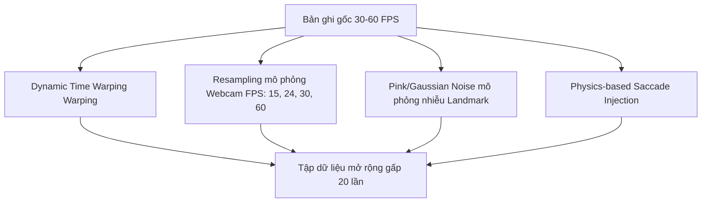
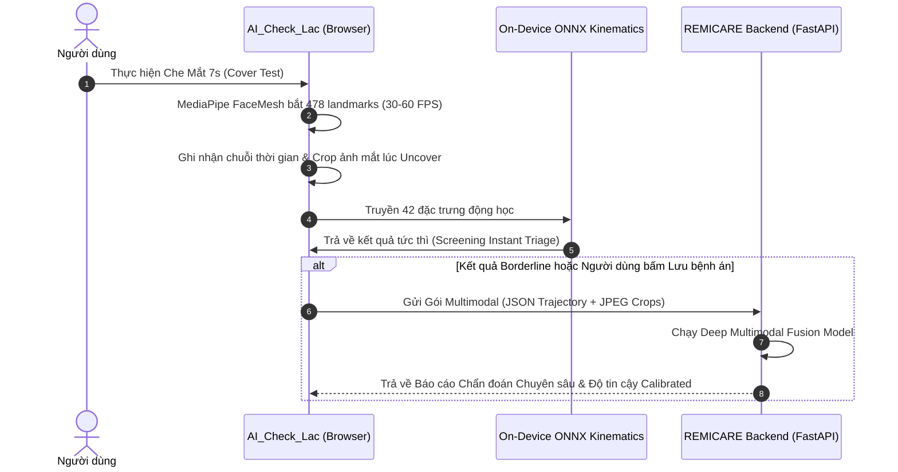

# CHIẾN LƯỢC TOÀN DIỆN CẢI TIẾN HUẤN LUYỆN AI SÀNG LỌC LÁC BẰNG CHUYỂN ĐỘNG MẮT (EYE-MOVEMENT STRABISMUS SCREENING)

> **Dự án liên quan:** 
> - Client Frontend: [`AI_Check_Lac`](file:///d:/AI_Check_Lac)
> - AI Backend API: [`REMICARE-STRABISMUS-AI-COVER-TEST`](file:///D:/REMICARE-STRABISMUS-AI-COVER-TEST)
> - Nghiên cứu & Huấn luyện: [`REMICARE_TRAIN_AI/COVER_TEST_METHOD`](file:///D:/REMICARE_TRAIN_AI/COVER_TEST_METHOD)
> 
> **Ngày lập:** 25/10/2026  
> **Chuyên mục:** Oculomotor Biometrics & Multimodal Deep Learning for Strabismus Screening

---

## MỤC LỤC
1. [Tổng quan hiện trạng & Nguyên nhân hiệu năng hiện tại thấp](#1-tổng-quan-hiện-trạng--nguyên-nhân-hiệu-năng-hiện-tại-thấp)
2. [Chiến lược dữ liệu: Thu thập, Đồng bộ & Tăng cường (Data Strategy & Augmentation)](#2-chiến-lược-dữ-liệu-thu-thập-đồng-bộ--tăng-cường-data-strategy--augmentation)
3. [Cải tiến Feature Engineering: Động học Chuyển động Mắt Y Sinh (Biomechanical Kinematics)](#3-cải-tiến-feature-engineering-động-học-chuyển-động-mắt-y-sinh-biomechanical-kinematics)
4. [Kiến trúc Mô hình Mới: Từ Hồi quy Tuyến tính sang Deep Spatiotemporal & Multimodal](#4-kiến-trúc-mô-hình-mới-từ-hồi-quy-tuyến-tính-sang-deep-spatiotemporal--multimodal)
5. [Tối ưu Huấn luyện: Hàm mất mát, Phân tầng chống Data Leakage & Hiệu chuẩn Xác suất](#5-tối-ưu-huấn-luyện-hàm-mất-mát-phân-tầng-chống-data-leakage--hiệu-chuẩn-xác-suất)
6. [Đồng bộ Kiến trúc Client-Server: Đưa Mô hình ONNX Chuyển động Mắt lên Trình duyệt](#6-đồng-bộ-kiến-trúc-client-server-đưa-mô-hình-onnx-chuyển-động-mắt-lên-trình-duyệt)
7. [Lộ trình Triển khai Chi tiết (Implementation Roadmap)](#7-lộ-trình-triển-khai-chi-tiết-implementation-roadmap)

---

## 1. TỔNG QUAN HIỆN TRẠNG & NGUYÊN NHÂN HIỆU NĂNG HIỆN TẠI THẤP

### 1.1. Hiện trạng Hiệu năng Huấn luyện (Dựa trên `training_report.json`)
Dữ liệu kiểm thử thực tế từ file báo cáo huấn luyện mới nhất [`training_report.json`](file:///D:/REMICARE_TRAIN_AI/COVER_TEST_METHOD/output/runs/fusion_latest/training_report.json):
- **Số lượng mẫu cực kỳ nhỏ:**
  - Chuỗi chuyển động (Trajectory): **41 bản ghi** (20 Normal, 21 Strabismus).
  - Ảnh mắt (Hirschberg images): **30 bản ghi** (26 Normal, chỉ **4 Strabismus** – mất cân bằng cực đoan).
- **Chỉ số đánh giá (5-Fold Cross-Validation):**
  - **Balanced Accuracy:** `63.45%` (Khoảng tin cậy 95% Bootstrap: `48.75%` – `78.22%`).
  - **Sensitivity (Độ nhạy):** `61.90%` (95% CI: `40.91%` – `82.36%`).
  - **Specificity (Độ đặc hiệu):** `65.00%` (95% CI: `41.65%` – `84.62%`).

> [!WARNING]
> Mức cận dưới của khoảng tin cậy (48.75%) thấp hơn cả việc dự đoán ngẫu nhiên (50%). Điều này cho thấy mô hình chưa sẵn sàng cho bất kỳ ứng dụng sàng lọc lâm sàng nào nếu không có cải tiến căn cơ.

### 1.2. Bốn "Nút thắt cổ chai" (Bottlenecks) Cốt tử
1. **Thiếu cặp dữ liệu thực sự (Lack of Paired Multimodal Data) & Naive Zero-Imputation:**
   - Trong [`train_fusion.py`](file:///D:/REMICARE_TRAIN_AI/COVER_TEST_METHOD/research/cover_test_multimodal/train_fusion.py), dữ liệu trajectory và ảnh đến từ 2 nhóm bệnh nhân khác nhau. 
   - Hệ thống xử lý bằng cách chèn số 0 vào 50% vector đặc trưng (`image block = 0` nếu là trajectory, `traj block = 0` nếu là ảnh) kèm 2 cờ `image_available`, `traj_available`.
   - Kết quả: Mô hình không thể học được sự tương quan chéo giữa góc lệch ảnh chụp tĩnh và biên độ tái định thị động học.
2. **Feature Engineering làm mờ tín hiệu quan trọng (Signal Washout):**
   - Trong [`features.py`](file:///D:/REMICARE_TRAIN_AI/COVER_TEST_METHOD/research/cover_test_timestamp/features.py), chỉ có **20 đặc trưng** thống kê toàn cục (`spread_x`, `spread_y`, `radius_p90`, `speed_median`, `speed_p90`, `speed_p99`, tương quan vận tốc).
   - Các thống kê này được tính gộp trên **toàn bộ thời gian quay** (7–10 giây). Tuy nhiên, chuyển động tái định thị (Refixation Saccade) chỉ xảy ra trong **150ms – 400ms ngay sau khi mở che**. Tính quantile trên toàn chuỗi làm tín hiệu vàng bị chìm hoàn toàn trong các chuyển động trôi dạt (drift), đảo mắt tự do hoặc chớp mắt.
3. **Mô hình Quá yếu (Underfitting Linear Baseline):**
   - Đang sử dụng `LogisticRegression(class_weight="balanced")`. Một hàm tuyến tính đơn giản không thể bóc tách tương tác phi tuyến phức tạp của chuyển động 2 mắt, vận tốc giật và độ trễ phản xạ.
4. **Sự đứt gãy giữa Client (`AI_Check_Lac`) và Bộ máy AI:**
   - Client [`AI_Check_Lac`](file:///d:/AI_Check_Lac) đang chạy cục bộ mô hình ONNX [`Small_MLP_32_16`](file:///d:/AI_Check_Lac/public/models/model_metadata.json) chỉ nhận **10 đặc trưng hình học tĩnh** (tỷ lệ mống mắt trên khung hình đơn).
   - Phần chuyển động mắt cover test trên client (`coverTestMeasurementService.js`) chỉ dùng các ngưỡng heuristic cứng (`normalizedDisplacement > 0.08`), không tận dụng AI chuỗi thời gian.
   - Script huấn luyện [`train.py`](file:///D:/REMICARE_TRAIN_AI/COVER_TEST_METHOD/research/cover_test_timestamp/train.py) lại ép cứng `source == "KOREAN_EYE_TRACKER"`, từ chối nhận dữ liệu webcam của client.

---

## 2. CHIẾN LƯỢC DỮ LIỆU: THU THẬP, ĐỒNG BỘ & TĂNG CƯỜNG (DATA STRATEGY & AUGMENTATION)

### 2.1. Tận dụng Data Flywheel từ Client `AI_Check_Lac`
Client `AI_Check_Lac` đã có sẵn cơ chế ghi nhận chuỗi thời gian chất lượng cao trong [`coverTestTimeSeriesService.js`](file:///d:/AI_Check_Lac/src/services/coverTestTimeSeriesService.js) và bộ lưu phiên sàng lọc. Cần kích hoạt quy trình thu thập dữ liệu tự động:
- **Định dạng bản ghi chuẩn:** Mỗi phiên sàng lọc lưu thành 1 tệp JSON chứa:
  - Thông tin thiết bị (webcam model, resolution, estimated FPS).
  - Chuỗi mốc thời gian thực (`timestampMs`, `t` tính bằng giây chính xác đến micro-giây qua `performance.now()`).
  - Tọa độ chuẩn hóa của tâm mống mắt (`leftIris`, `rightIris`), góc mắt trong/ngoài (`canthus`) từ MediaPipe FaceMesh (478 keypoints).
  - Nhãn phân đoạn pha: `BASELINE`, `COVER_LEFT`, `UNCOVER_LEFT`, `COVER_RIGHT`, `UNCOVER_RIGHT`.
  - Bộ ảnh crop mắt (JPEG 256x256) tại 3 thời điểm then chốt: Lúc che ổn định (giây thứ 5-6), Ngay sau khi mở che ($t+200\text{ms}$), và Khi mắt đã tái định thị ($t+1000\text{ms}$).

### 2.2. Kỹ thuật Tăng cường Dữ liệu Chuỗi Thời gian (Time-Series Data Augmentation)
Vì số lượng bản ghi thực tế còn hạn chế, các kỹ thuật tăng cường dữ liệu chuyên biệt cho chuyển động mắt sinh học sau đây là bắt buộc:



1. **Mô phỏng Đa tốc độ Khung hình (Multi-rate Resampling):**
   - Trình duyệt và camera người dùng thực tế có thể chạy từ 15 đến 60 FPS hoặc drop frame ngẫu nhiên.
   - Sử dụng thuật toán đa nội suy (PCHIP - Piecewise Cubic Hermite Interpolating Polynomial) để mô phỏng lại các tần số lấy mẫu 20, 24, 30, 45, 60 Hz kèm việc cố tình drop 1-3 khung hình ngẫu nhiên để mô hình học tính chịu lỗi.
2. **Time-Warping (Biến thiên thời gian phản xạ):**
   - Phản xạ tái định thị của mỗi người có độ trễ dao động (150ms – 350ms).
   - Kéo giãn hoặc co ngắn trục thời gian cục bộ trong khoảng $\pm 20\%$ trong cửa sổ mở che (Uncover Window) bằng phương pháp Time-Warping không làm thay đổi biên độ chuyển động.
3. **Mô phỏng Nhiễu Cảm biến (Sensor & Micro-tremor Jitter):**
   - Thêm nhiễu màu hồng (1/f Pink Noise) biên độ nhỏ ($\sigma \approx 0.002$ tọa độ chuẩn hóa) mô phỏng rung giật sinh lý tự nhiên (physiological nystagmus / ocular tremor) và sai số phát hiện của MediaPipe.
4. **Mô hình Sinh học Giả lập Cử động Lác (Physics-based Saccadic Injection):**
   - Lấy chuỗi chuyển động của mắt người bình thường (định thị ổn định).
   - Tiêm vào một cử động giật chuẩn theo **Định luật Main Sequence** của chuyển động mắt:
     $$v(t) = V_{peak} \cdot \exp\left( - \frac{(t - t_{peak})^2}{2 \sigma^2} \right)$$
     với $V_{peak}$ tương ứng các độ lệch lác khác nhau: 5, 10, 15, 25 Prism Diopters (PD).
   - Bằng cách này, có thể sinh ra hàng nghìn mẫu bán nhân tạo (semi-synthetic) có cơ sở sinh lý mắt vững chắc để tiền huấn luyện (pre-training) mạng nơ-ron.

---

## 3. CẢI TIẾN FEATURE ENGINEERING: ĐỘNG HỌC CHUYỂN ĐỘNG MẮT Y SINH (BIOMECHANICAL KINEMATICS)

Thay vì chỉ tính 20 thống kê thô trên toàn bộ chuỗi, cần xây dựng bộ **Đặc trưng Động học Chuyên sâu (Kinematic Biomarkers)** phân tách theo từng pha lâm sàng:

### 3.1. Phân khúc Pha Lâm sàng (Clinical Phase Slicing)
Bắt buộc chia tín hiệu thành 3 cửa sổ phân tích độc lập:
1. **Pha Baseline ($T_{baseline}$):** 1.5 giây đầu khi mở cả hai mắt.
2. **Pha Che ($T_{cover}$):** Thời gian che mắt (7 giây). Phân tích mắt KHÔNG che có bị giật định thị hay không (phát hiện lác hiện - Tropia của mắt kia).
3. **Pha Mở che ($T_{uncover}$):** Quan trọng nhất! Chia nhỏ thành 2 cửa sổ:
   - **Early Dynamic Window ($t_0 \to t_0 + 500\text{ms}$):** Cửa sổ bắt chuyển động tái định thị (Refixation Saccade).
   - **Settling Stability Window ($t_0 + 500\text{ms} \to t_0 + 2000\text{ms}$):** Cửa sổ đánh giá khả năng duy trì định thị sau khi hợp thị.

### 3.2. Bảng Đặc trưng Động học Mắt Mới Đề xuất (42 Đặc trưng)

| Nhóm đặc trưng | Tên đặc trưng | Ý nghĩa y sinh / Cơ sở toán học |
| :--- | :--- | :--- |
| **Saccade Dynamics (Động học giật mắt)** | `uncover_peak_velocity_norm` | Vận tốc cực đại của mắt vừa mở che trong 500ms đầu. |
| | `uncover_peak_acceleration` | Gia tốc cực đại (cho thấy lực co cơ vận nhãn tức thời). |
| | `refixation_latency_ms` | Thời gian từ lúc mở che đến khi đạt đỉnh vận tốc ($180 - 350\text{ms}$). |
| | `main_sequence_ratio` | Tỷ số giữa $V_{peak}$ và Biên độ $A$. Saccade thật luôn có $V_{peak} / A \approx \text{const}$ hoặc tiệm cận hàm mũ. |
| **Phục hồi & Ổn định (Settling & Damping)** | `settling_time_ms` | Thời gian để mắt ổn định trong phạm vi $\pm 5\%$ vị trí cuối cùng. |
| | `exponential_decay_tau` | Hằng số thời gian $\tau$ khớp với phương trình hồi quy $x(t) = x_\infty + \Delta x \cdot e^{-t/\tau}$. |
| | `post_uncover_drift_speed` | Vận tốc trôi dạt sau pha giật (phát hiện nystagmus hoặc mỏi cơ). |
| **Định thị (Fixation Stability)** | `baseline_BCEA` | Diện tích elip bao phủ 68% vị trí định thị trong pha Baseline. |
| | `uncover_BCEA` | Diện tích elip bao phủ vị trí định thị trong pha ổn định sau mở che. |
| **Phối hợp Hai mắt (Binocular Coordination)** | `conjugate_velocity_correlation` | Hệ số tương quan Pearson giữa vận tốc 2 mắt theo trục ngang và trục dọc. |
| | `vergence_drift_rate` | Tốc độ thay đổi khoảng cách giữa 2 mống mắt ($d(x_{right} - x_{left})/dt$). |
| | `hering_law_asymmetry_index` | Chỉ số bất đối xứng chuyển động: $\frac{\|v_{left}\| - \|v_{right}\|}{\|v_{left}\| + \|v_{right}\| + \epsilon}$. Ở mắt bình thường $\approx 0$. |
| **Độ lệch Không gian (Displacement Metrics)** | `signed_dx_from_baseline` | Độ lệch ngang có dấu so với baseline (Dương: Temporal $\to$ Exophoria/tropia; Âm: Nasal $\to$ Esophoria/tropia). |
| | `signed_dy_from_baseline` | Độ lệch dọc có dấu (Hyper/Hypotropia). |
| | `total_displacement_norm` | $\sqrt{\Delta x^2 + \Delta y^2} / \text{eyeWidth}$ (chuẩn hóa theo bề rộng mắt). |

#### Công thức Diện tích Elip Định thị (BCEA - Bivariate Contour Ellipse Area):
$$BCEA = 2 k \pi \sigma_x \sigma_y \sqrt{1 - \rho^2}$$
*(Với $k = 1.14$ cho vùng tin cậy 68%, $\sigma_x, \sigma_y$ là độ lệch chuẩn tọa độ, $\rho$ là hệ số tương quan giữa $x$ và $y$)*. Mắt lác hoặc nhược thị có $BCEA$ cao hơn đáng kể so với mắt bình thường.

---

## 4. KIẾN TRÚC MÔ HÌNH MỚI: TỪ HỒI QUY TUYẾN TÍNH SANG DEEP SPATIOTEMPORAL & MULTIMODAL

### 4.1. Cấu trúc Mô hình Đề xuất: 3 Cấp độ (Tiered Architecture)

```
                            ┌──────────────────────────────────────────────┐
                            │      Dữ liệu Đầu vào (Webcam Video)          │
                            └──────────────────────┬───────────────────────┘
                                                   │
                         ┌─────────────────────────┴─────────────────────────┐
                         ▼                                                   ▼
            ┌─────────────────────────┐                         ┌─────────────────────────┐
            │   Chuỗi Chuyển động     │                         │   Ảnh Mắt Lúc Mở Che    │
            │  (Kinematic Time-Series)│                         │     (256x256 Crop)      │
            └────────────┬────────────┘                         └────────────┬────────────┘
                         │                                                   │
                         ▼                                                   ▼
            ┌─────────────────────────┐                         ┌─────────────────────────┐
            │  1D-CNN + BiLSTM với    │                         │  Lightweight ConvNeXt   │
            │    Temporal Attention   │                         │    hoặc MobileNetV4     │
            │  (Bắt cử động giật mắt) │                         │  (Bắt phản xạ Hirschberg│
            └────────────┬────────────┘                         └────────────┬────────────┘
                         │                                                   │
                         │             ┌───────────────────────┐             │
                         └────────────►│ Cross-Attention Fusion│◄────────────┘
                                       └───────────┬───────────┘
                                                   ▼
                                       ┌───────────────────────┐
                                       │   Classification Head │
                                       │  - Normal vs Strabism │
                                       │  - Subtype: Eso/Exo   │
                                       │  - Confidence Score   │
                                       └───────────────────────┘
```

### 4.2. Chi tiết các Khối Kiến trúc

#### Khối 1: Xử lý Chuỗi Thời gian (Temporal Kinematics Network)
- **Đầu vào:** Tensor $(B, C=8, T=150)$ tương ứng 8 kênh ($x_L, y_L, v_{xL}, v_{yL}, x_R, y_R, v_{xR}, v_{yR}$) lấy mẫu ở 30 FPS trong 5 giây xung quanh thời điểm mở che.
- **Lớp 1D-CNN Conv Block:** 3 tầng Conv1D với kernel sizes (3, 5, 7) kèm BatchNorm và GELU để nắm bắt các biến thiên vận tốc tức thời ở nhiều độ phân giải thời gian.
- **Lớp Bi-directional LSTM:** 2 tầng BiLSTM (hidden size = 64) nắm bắt quán tính và hướng hồi quy của mắt.
- **Temporal Attention:** Cơ chế trọng số tự động học cách tập trung cao nhất vào cửa sổ 150-400ms sau khi mở che, tự động triệt tiêu các khoảng thời gian nhấp nháy hoặc trôi mắt tự do.

#### Khối 2: Xử lý Ảnh Mắt (Spatial Eye Crop Feature Extractor)
- **Đầu vào:** Ảnh màu cắt riêng 2 mắt tại thời điểm $t_{uncover} + 200\text{ms}$.
- **Trích xuất:** Sử dụng backbone nhẹ (MobileNetV4-Small hoặc EfficientNet-B0 tiền huấn luyện) để trích xuất đặc trưng Hirschberg corneal reflection và độ lệch đồng tử.

#### Khối 3: Cross-Modal Attention Fusion (Thay thế Zero-Imputation)
- Thay vì gán 0 cho modal thiếu, sử dụng kiến trúc **Cross-Attention**:
  - Trajectory tokens đóng vai trò Query ($Q$).
  - Image tokens đóng vai trò Key ($K$) và Value ($V$).
- Nếu một trong hai nguồn dữ liệu không có (ví dụ chỉ có video chuyển động không có ảnh nét), mạng sử dụng cơ chế **Masked Modality Dropout** (học cách suy luận độc lập từ từng nhánh hoặc kết hợp cả hai khi đủ dữ liệu).

#### Khối 4: Baseline GBDT Nâng cao cho On-Device (LightGBM/XGBoost)
- Đối với môi trường web thời gian thực trên trình duyệt của `AI_Check_Lac`:
  - Trích xuất 42 đặc trưng động học nêu tại Mục 3.
  - Huấn luyện mô hình **LightGBM** hoặc **XGBoost Classifier** với độ sâu cây giới hạn (`max_depth=4`, `num_leaves=15`) để chống overfitting trên tập mẫu nhỏ.
  - Chuyển đổi mô hình sang định dạng **ONNX** (kích thước < 200 KB) để chạy trực tiếp trên WebAssembly qua `onnxruntime-web`.

---

## 5. TỐI ƯU HUẤN LUYỆN: HÀM MẤT MÁT, PHÂN TẦNG CHỐNG DATA LEAKAGE & HIỆU CHUẨN XÁC SUẤT

### 5.1. Chiến lược Phân tầng Bệnh nhân Nghiêm ngặt (Patient-Level Group K-Fold)
- **Lỗi phổ biến hiện nay:** Một bệnh nhân có thể được thực hiện 3 chu kỳ cover test (Cycle 1, 2, 3). Nếu chia ngẫu nhiên, các chu kỳ của cùng một người sẽ lọt vào cả tập train và validation $\to$ gây **Data Leakage** và số liệu ảo.
- **Giải pháp:** Bắt buộc áp dụng `StratifiedGroupKFold` trên mã định danh bệnh nhân (`subject_id` hoặc `patient_id`). Tất cả chu kỳ của một người chỉ được nằm trong duy nhất 1 fold.

### 5.2. Hàm Mất Mát Chuyên biệt (Custom Loss Functions)
Để xử lý mất cân bằng lớp (Strabismus ít hơn Normal):
1. **Focal Loss:**
   $$\mathcal{L}_{focal} = - \alpha_t (1 - p_t)^\gamma \log(p_t)$$
   với $\gamma = 2.0$ tập trung tối đa gradient vào các ca khó phân biệt (micro-strabismus hoặc phoria nhỏ).
2. **Supervised Contrastive Loss:**
   Ép các biểu diễn vector (embeddings) của người bình thường co cụm lại với nhau, đồng thời đẩy xa các vector chuyển động lác có biên độ và hướng khác nhau trong không gian đặc trưng.

### 5.3. Hiệu chuẩn Xác suất Lâm sàng (Probability Calibration)
- Điểm yếu của Softmax và Logistic Regression trên dữ liệu mất cân bằng là xác suất đầu ra không phản ánh đúng tỷ lệ rủi ro lâm sàng thực tế.
- **Phương pháp:** Áp dụng **Isotonic Regression** hoặc **Platt Scaling** trên tập Out-of-Fold (OOF) predictions.
- **Quy tắc Phân định 3 Vùng (Three-Zone Decision Boundary):**
  - $p < 0.35$: **Bình thường (NORMAL)**.
  - $0.35 \le p \le 0.65$: **Nghi ngờ / Cần đánh giá thêm (INCONCLUSIVE / BORDERLINE)** $\to$ Hướng dẫn người dùng đo lại hoặc đề nghị khám chuyên khoa mắt.
  - $p > 0.65$: **Nguy cơ Lác (STRABISMUS DETECTED)** kèm phân loại hướng (Esotropia / Exotropia / Hypertropia).

---

## 6. ĐỒNG BỘ KIẾN TRÚC CLIENT-SERVER: ĐƯA MÔ HÌNH ONNX CHUYỂN ĐỘNG MẮT LÊN TRÌNH DUYỆT

Sự kết hợp tối ưu giữa [`AI_Check_Lac`](file:///d:/AI_Check_Lac) và Backend:



### Các bước Cụ thể:
1. **Loại bỏ ràng buộc `SOURCE = "KOREAN_EYE_TRACKER"`:**
   - Trong [`train.py`](file:///D:/REMICARE_TRAIN_AI/COVER_TEST_METHOD/research/cover_test_timestamp/train.py) và [`features.py`](file:///D:/REMICARE_TRAIN_AI/COVER_TEST_METHOD/research/cover_test_timestamp/features.py), bổ sung domain `"BROWSER_MEDIAPIPE"` và chuẩn hóa tọa độ sao cho tương thích với chuẩn đầu ra của `coverTestTimeSeriesService.js`.
2. **Xuất mô hình ONNX nhẹ:**
   - Sau khi huấn luyện mô hình đặc trưng động học, xuất ra file `cover_test_kinematics_v2.onnx` đặt trong thư mục [`public/models/`](file:///d:/AI_Check_Lac/public/models/).
   - Cập nhật [`model_metadata.json`](file:///d:/AI_Check_Lac/public/models/model_metadata.json) để hỗ trợ cả mô hình tĩnh 10 đặc trưng lẫn mô hình động học 42 đặc trưng.
3. **Nâng cấp `coverTestMeasurementService.js`:**
   - Kết nối dữ liệu từ chuỗi `uncoverFrames` trực tiếp vào pipeline trích xuất 42 đặc trưng và gọi `onnxruntime-web` để phân loại ngay tại client, thay vì chỉ so sánh với một ngưỡng tĩnh `displacementThreshold`.

---

## 7. LỘ TRÌNH TRIỂN KHAI CHI TIẾT (IMPLEMENTATION ROADMAP)

### Giai đoạn 1: Chuẩn hóa Schema & Bộ Thu thập Dữ liệu (Tuần 1 - 2)
- [ ] Cập nhật schema lưu trữ dữ liệu phiên của `AI_Check_Lac` để tự động đóng gói cặp **Trajectory + 3 Khung ảnh Crop mắt chuẩn nét** vào thư mục local / API.
- [ ] Bỏ giới hạn cứng nguồn dữ liệu (`source == "KOREAN_EYE_TRACKER"`) trong `REMICARE_TRAIN_AI`, hỗ trợ dữ liệu thu từ webcam browser.
- [ ] Viết script validate kiểm tra tính toàn vẹn (monotonic timestamps, missing rate < 10%).

### Giai đoạn 2: Nâng cấp Feature Extractor Động học Mắt (Tuần 3 - 4)
- [ ] Triển khai module `kinematic_features.py` tính toán đầy đủ 42 đặc trưng y sinh (Main Sequence, BCEA, Settling Time, Latency, Hering Asymmetry).
- [ ] Phân tích riêng rẽ từng pha lâm sàng (`Baseline`, `Cover`, `Uncover 500ms`, `Settling 1500ms`).
- [ ] Huấn luyện mô hình Baseline mới bằng LightGBM / CatBoost với `StratifiedGroupKFold`.
- [ ] Đo lường mục tiêu: Nâng Balanced Accuracy từ `63.45%` lên $\ge \mathbf{78\%}$ trên tập OOF.

### Giai đoạn 3: Tăng cường Dữ liệu Động học & Mô phỏng Sinh học (Tuần 5 - 6)
- [ ] Xây dựng generator tăng cường dữ liệu: Multi-rate Resampling (15-60 FPS), Time-Warping, Pink noise jitter.
- [ ] Triển khai thuật toán tiêm xung cử động lác (Physics-based Saccade Injection) để tạo tập tiền huấn luyện 5,000 mẫu bán nhân tạo.
- [ ] Đánh giá độ bền bỉ (robustness) của mô hình trước các tình huống webcam bị giật khung hình hoặc điều kiện ánh sáng thay đổi.

### Giai đoạn 4: Kiến trúc Học sâu Đa phương thức & Triển khai ONNX (Tuần 7 - 8)
- [ ] Xây dựng mô hình 1D-CNN + BiLSTM với Temporal Attention trên PyTorch.
- [ ] Tích hợp nhánh ảnh mắt (Eye Crops) qua Cross-Attention Fusion với Masked Modality Dropout.
- [ ] Hiệu chuẩn đường cong xác suất với Isotonic Regression.
- [ ] Xuất mô hình sang định dạng ONNX INT8, tích hợp vào `AI_Check_Lac` để chạy sàng lọc thời gian thực mượt mà trên trình duyệt người dùng.
- [ ] Mục tiêu cuối cùng: Đạt **Balanced Accuracy $\ge \mathbf{88\%}$, Sensitivity $\ge \mathbf{90\%}$** trên tập thử nghiệm độc lập.

---

## 8. KẾT LUẬN & KIẾN NGHỊ HÀNH ĐỘNG NGAY
Việc cải tiến AI sàng lọc chuyển động mắt trong dự án không đơn thuần là thay đổi siêu tham số (hyperparameters), mà cần **tái cấu trúc theo đúng bản chất sinh lý học mắt (Oculomotor Biomechanics)**:
1. **Ưu tiên số 1:** Sửa bộ trích xuất đặc trưng `features.py` để tập trung vào **cửa sổ 500ms sau khi mở che**, bổ sung các chỉ số vận tốc đỉnh, độ trễ và diện tích elip BCEA.
2. **Ưu tiên số 2:** Thay thế mô hình Logistic Regression bằng **LightGBM / XGBoost** cho mô hình bảng đặc trưng, hoặc **1D-CNN + BiLSTM Attention** cho chuỗi thời gian.
3. **Ưu tiên số 3:** Kết nối cơ chế sinh dữ liệu của `AI_Check_Lac` vào pipeline huấn luyện của `REMICARE_TRAIN_AI` để tạo dòng chảy dữ liệu liên tục (Data Flywheel), giải quyết dứt điểm vấn đề thiếu mẫu.
